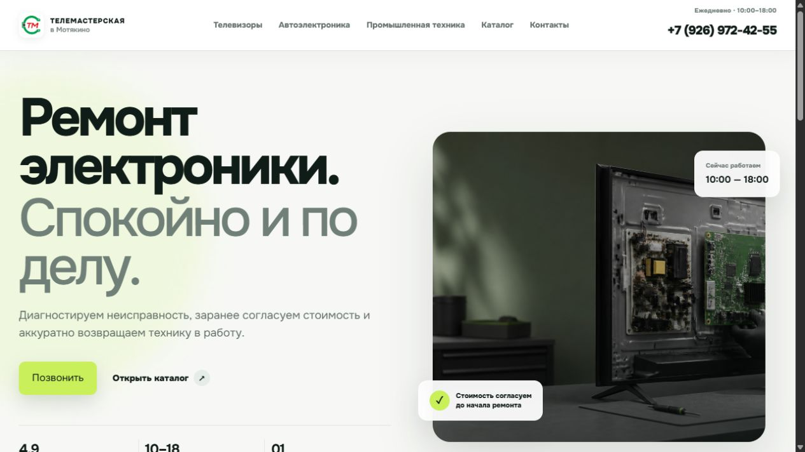
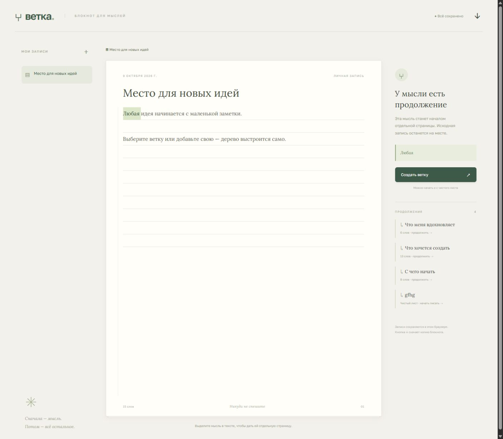
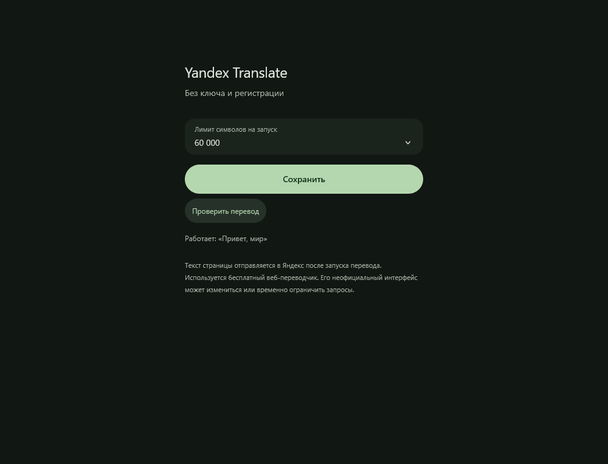
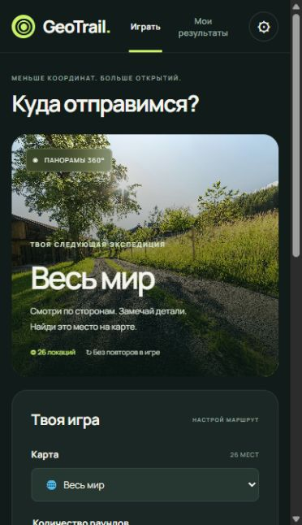

# Иван / fl1ppy

### Сайты для бизнеса · Telegram-боты · Веб-инструменты

Создаю сайты, Telegram-ботов и небольшие веб-инструменты с помощью AI. Уточняю задачу, собираю решение по этапам и проверяю ключевые сценарии. Есть проект для мастерской электроники и собственные продукты.

[Написать в Telegram](https://t.me/Ivaanf7) · [Email](mailto:ivanzippi2010@gmail.com)

[Резюме PDF](resume-ivan.pdf) · [Портфолио PDF — 6 кейсов](portfolio-ivan.pdf)

## С чем могу помочь

- Страница услуги, лендинг или небольшой каталог.
- Доработка интерфейса, адаптивной вёрстки, формы или поиска.
- Telegram-бот с меню, анкетой, заявками и модерацией.
- Небольшой веб-инструмент или понятная автоматизация рабочего процесса.

Объём, критерии готовности, срок и стоимость согласуем перед началом.

## Избранные проекты

### 1. Сайт мастерской электроники

**Проект для заказчика.** Страницы услуг, каталог деталей, поиск и фильтры, карточки товаров и управление содержимым. Разработка и доработки по обратной связи заказчика.

[Открыть сайт](https://tvmaster.pro/)

### 2. Pulse VPN бот

**Собственный проект.** Telegram-меню подписочного сервиса: тарифы, профиль, пробный период, поддержка и реферальные сценарии. Python, aiogram, SQLite. Две локальные проверки базы прошли. Реальный приём платежей и автоматическая выдача доступа остаются отдельной незавершённой интеграцией.

### 3. Pulse Creator

**Собственный проект.** Анкета партнёра, материалы, модерация с причинами отказа, промокоды и учёт начислений. Покупки подтверждаются администратором. В SQLite предусмотрена защита от повторного зачёта ID покупки.

### 4. Ветка

**Собственный проект.** Блокнот: выделить мысль, создать дочернюю заметку и сохранить связь с исходной записью. Автосохранение в браузере.

### 5. Luma Translate

**Собственный проект.** Расширение Firefox: перевод страницы, динамические текстовые блоки, возврат оригинала и лимиты запросов. 12 локальных тестов прошли. Используется неофициальный веб-интерфейс Яндекса; постоянная установка требует отдельного оформления подписи Mozilla.

### 6. GeoTrail

**Собственный проект.** Локальная браузерная игра: 26 панорам 360°, карта, таймер, сложность и история результатов. 5 локальных тестов прошли. Панорамы отдельные, без перемещения по улицам.

## English

I build business websites, Telegram bots and small web tools with AI-assisted development. I work with scoped tasks, iterate on feedback and check core user journeys. Available for remote freelance projects.

[Telegram](https://t.me/Ivaanf7) · [Email](mailto:ivanzippi2010@gmail.com)
